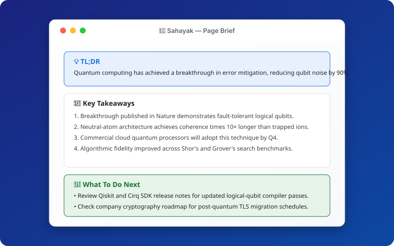
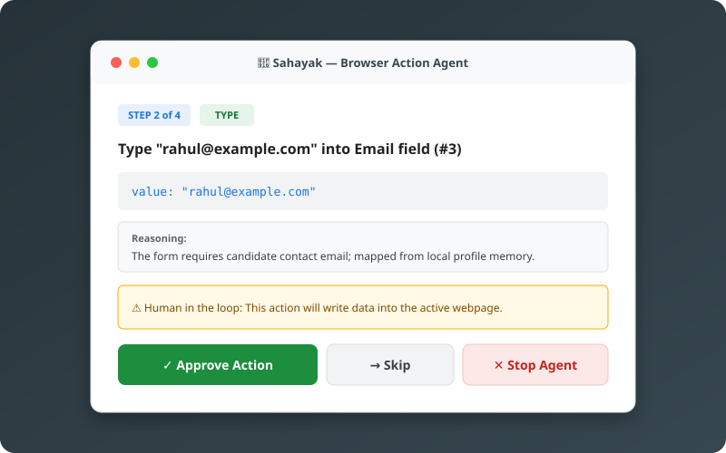
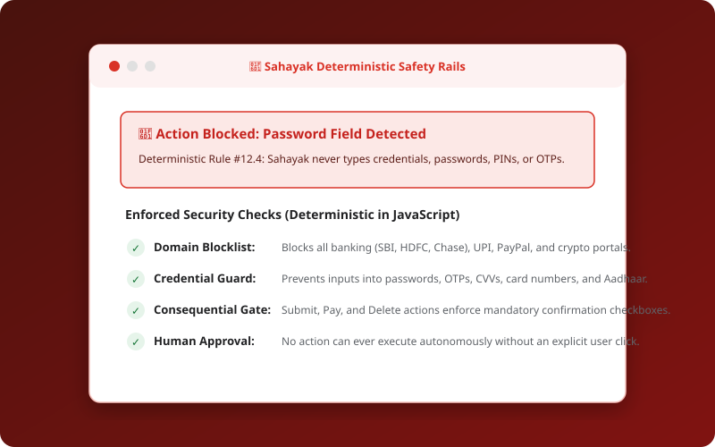

# 🤖 Sahayak — AI Browser Assistant

[](https://developer.chrome.com/docs/extensions/mv3/)
[](CHANGELOG.md)
[](LICENSE)
[](#-development--packaging)

> **Your browser AI co-pilot** — reads, explains, sees, and acts on web pages with your explicit approval.

Sahayak is a Chrome Extension (Manifest V3) that lives in your browser's side panel. Built with Google's **Gemini 2.5 Flash** and resilient failover via **Groq (Llama-3.1-8b)**, Sahayak digests dense articles, answers visual questions from screenshots, manages personal profiles for one-click form completion, and executes browser actions step-by-step under strict **deterministic safety rails**.

---

## 📸 Visual Showcase

| 📄 Intelligent Reader Brief | 🦾 Supervised Browser Agent | 🛡️ Deterministic Safety Rails |
| :---: | :---: | :---: |
|  |  |  |
| *Mozilla Readability 3-part brief with key takeaways* | *Numbered element badges with human approval* | *Hardcoded domain and credential field blocklists* |

---

## ✨ Complete Feature Breakdown

### Phase 1: The Reader & Explainer
* **Structured 3-Part Brief:** One-click article extraction powered by Mozilla Readability. Delivers:
  * **💡 TL;DR:** Single-sentence core insight.
  * **📌 5 Key Takeaways:** Numbered breakdown of critical facts.
  * **🎯 Next Steps:** Concrete actionable recommendations.
  * Article metadata (word count, reading time, source) with automatic paywall and teaser detection.
* **Text Explanation:** Paste or select any text on any page for an instant, plain-English breakdown with one-click copy.
* **Bilingual English & Hinglish:** Seamlessly toggle between standard English and Roman-script Hinglish (`hi-en`) across summaries and replies.
* **Right-Click Context Menu:** Highlight text anywhere to "Explain", "Summarise", or "Translate" directly from the native context menu.

### Phase 2: The Chat & Vision Engine
* **In-Page Grounded Chat:** Chat with the current page. Answers are strictly grounded in live DOM context, with conversation memory and one-click follow-up prompt chips.
* **Multimodal Screenshot Q&A:** Capture full-page or interactive cropped regions of the viewport. Visual reasoning with Gemini Flash inspects charts, infographics, tables, and layouts.
* **Free-Tier Resilience & Fallback:**
  * Exponential backoff with jitter on HTTP 429 quota exhaustion.
  * Automatic failover to Groq (`llama-3.1-8b-instant`) for text tasks if Gemini quota is reached.
  * High-visibility banner notifications keep you informed of model state.

### Phase 3: The Supervised Agent ("The Hands")
* **Interactive Element Scanner:** Scans clickable links, buttons, inputs, textareas, and dropdowns, generating an accessibility-aligned `actionMap`.
* **Numbered Visual Badges:** Overlays high-contrast numbered badges directly over interactive elements on the page.
* **Supervised Step-by-Step Loop:**
  * Proposes one concrete action at a time via an `ActionCard` (e.g. *Type "John" into Element #3*).
  * Requires explicit human approval before firing any event.
  * Includes a **Dry-Run Mode** checkbox to preview actions without touching the DOM.
  * Step budget limiter (default 10 steps) with a persistent emergency **[STOP]** button.
* **Synthetic Event Dispatcher:** Dispatches `pointerdown`, `mousedown`, `focus`, native property descriptor setters, and `input`/`change` events compatible with React, Vue, and Angular forms.

### Phase 4: Memory, Custom Skills & Safety Rails
* **Local Profile Memory:** Store personal, academic, and professional details (name, email, phone, college, degree, bio, GitHub, LinkedIn) locally in `chrome.storage.local`. Autofill forms and adjust response tone with zero retyping.
* **One-Click Saved Skills:**
  * Pre-loaded with built-in skills: *📝 Exam Notes*, *🗣️ Explain in Hinglish*, *💬 Reply Politely*, and *📋 Fill Form From Profile*.
  * Create custom prompt templates with dynamic variables (`{{selectedText}}`, `{{profile.fullName}}`, etc.).
  * Export and import skills collection as portable `sahayak-skills.json`.
* **Deterministic Safety Rails:**
  * **Domain Blocklist:** Blocks reading or automation on netbanking, payment gateways, UPI portals, crypto exchanges, and government ID sites.
  * **Field Blocklist:** Hardcoded protection preventing typing into password, PIN, OTP, CVV, card number, Aadhaar, and SSN fields.
  * **Consequential Confirmation Gate:** Actions with consequential keywords (*submit*, *pay*, *purchase*, *delete*, *remove*, *transfer*) require ticking an explicit warning confirmation before the Approve button unlocks.

---

## 🏗️ Project Architecture

```text
AIBrowser/
├── manifest.json              # Chrome Manifest V3 descriptor
├── background/
│   └── index.js               # Service worker, message routing & agent loop
├── content/
│   ├── index.js               # Content script entry point
│   ├── reader.js              # DOM cloning & Readability article extractor
│   ├── scanner.js             # Interactive DOM element scanner
│   ├── overlay.js             # Numbered badge renderer
│   ├── executor.js            # Synthetic event dispatcher (React/Vue-safe)
│   └── lib/
│       └── Readability.js     # Mozilla Readability engine
├── safety/
│   ├── blocklists.js          # Regex blocklists (domains, sensitive inputs, consequential verbs)
│   ├── consequential.js       # Action consequence evaluator
│   └── guardrails.js          # Unified safety check pipeline
├── services/
│   ├── ai/
│   │   ├── geminiProvider.js  # Google Gemini REST API client
│   │   ├── groqProvider.js    # Groq OpenAI-compatible client
│   │   ├── modelGateway.js    # Model router & fallback orchestrator
│   │   ├── promptBuilder.js   # Prompt templates & profile injector
│   │   └── retryWithFallback.js# Backoff jitter & failover handler
│   ├── state/
│   │   └── agentStateMachine.js# Finite state machine for supervised agent
│   └── storage/
│       ├── profileStore.js    # Local profile memory CRUD
│       └── skillsStore.js     # Saved skills engine CRUD & template engine
├── sidepanel/
│   ├── index.html             # Side panel DOM structure
│   ├── app.js                 # UI controller, routing & tab state
│   ├── components/
│   │   ├── ActionCard.js      # Agent approval card with consequential gate
│   │   ├── AgentView.js       # Agent execution UI, step counter & stop button
│   │   ├── ChatView.js        # DOM-grounded chat & follow-up chips
│   │   ├── ProfileView.js     # Profile memory management form
│   │   ├── SettingsView.js    # API keys & model preference manager
│   │   ├── SkillsView.js      # Saved skills library, modal & import/export
│   │   ├── SummaryView.js     # 3-part brief & article metadata
│   │   └── VisionView.js      # Screenshot capture & visual Q&A
│   └── styles/
│       └── panel.css          # Dark-mode design system & animations
├── scripts/
│   ├── build-zip.js           # Zero-dependency release packager
│   └── run-tests.js           # Comprehensive automated test suite
├── docs/
│   ├── landing/index.html     # GitHub Pages product landing page
│   ├── screenshots/           # SVG architecture & feature previews
│   └── implementation-plan.md # Specification & slice roadmap
├── package.json               # Test & build scripts
├── LICENSE                    # MIT License
└── CHANGELOG.md               # Version history
```

---

## 🚀 Quickstart Installation

### Option A: Install from Release ZIP (Recommended)
1. Download the latest `sahayak-v1.0.0.zip` from [Releases](https://github.com/your-username/sahayak/releases).
2. Unzip the archive to a folder on your computer.
3. Open Google Chrome (or Brave, Edge, Arc) and navigate to `chrome://extensions`.
4. Turn on **Developer mode** in the top-right corner.
5. Click **Load unpacked** in the top-left corner.
6. Select the unzipped folder.
7. Click the Chrome puzzle icon in the toolbar and pin **Sahayak**.

### Option B: Clone from Source
```bash
git clone https://github.com/your-username/sahayak.git
cd sahayak
```
Then load the folder directly via `chrome://extensions` as an unpacked extension.

---

## ⚙️ Configuration

1. Click the **Sahayak** icon in your toolbar to open the side panel.
2. Click the **⚙️ Settings** icon in the header.
3. **Primary Model (Gemini):**
   * Get a free API key from [Google AI Studio](https://aistudio.google.com/apikey).
   * Paste it into the **Gemini API Key** field.
4. **Backup Model (Optional Groq Fallback):**
   * Get a free key from [Groq Console](https://console.groq.com/keys).
   * Paste it into the **Groq API Key** field.
5. Click **Save Keys**.

> **Note on Privacy:** Your API keys and profile information are stored exclusively in your browser's `chrome.storage.local`. They are never proxied or transmitted to any third-party backend servers.

---

## 📖 Usage Guide & Examples

### 1. Summarising Articles
* Navigate to any news article, blog post, or documentation page.
* Open Sahayak and switch to the **Summary** tab.
* Click **Summarise Page**.
* View the 3-part breakdown: TL;DR, 5 bullet points, and actionable next steps.

### 2. In-Page Grounded Chat
* Switch to the **Chat** tab.
* Type a question regarding the active page (e.g. *"What are the prerequisites mentioned in section 2?"*).
* Sahayak extracts text from the live DOM and provides grounded answers with follow-up chips.

### 3. Visual Screenshot Q&A
* Switch to the **Vision** tab.
* Click **Full Viewport** or **Select Area** (draw a crop box over an infographic or chart).
* Type your question (e.g. *"What does the blue trend line represent in this graph?"*) and click **Ask Vision**.

### 4. Running the Supervised Agent
* Navigate to a form (e.g. an event registration page).
* Switch to the **Agent** tab.
* Enter your goal: *"Fill the registration form using my profile details"*.
* Click **Start Task**.
* Sahayak highlights interactive elements with numbered badges and presents an `ActionCard`.
* Review the action, verify the target element, and click **Approve** (or **Skip** / **Stop**).

### 5. Managing Saved Skills
* Switch to the **Skills** tab.
* Click **📝 Exam Notes** to produce structured revision notes for the open page.
* Click **+ Create New Skill** to save your own custom prompts with template variables like `{{selectedText}}` or `{{profile.fullName}}`.
* Use **Export All** to backup your skills or share them with teammates.

---

## 🛡️ Deterministic Safety Principles

Sahayak adheres to strict security guardrails that run at the code level, completely independent of the LLM:

1. **Deterministic Domain Blocklist:**
   Websites matching banking domains (`onlinesbi`, `hdfcbank`, `chase`), payment gateways (`paypal`, `stripe`, `razorpay`), UPI portals, cryptocurrency exchanges (`binance`, `coinbase`), and government identity portals (`uidai`, `incometax`) are automatically blocked. No page content is sent to AI models, and the agent refuses execution.
2. **Deterministic Field Blocklist:**
   Inputs with type `password` or names/labels containing `otp`, `pin`, `cvv`, `card`, `expiry`, `ssn`, or `aadhaar` are completely blocked from automated typing.
3. **Consequential Action Warning:**
   Whenever an action is predicted to submit a form, make a payment, delete data, or transfer funds, a warning card requires an explicit manual confirmation checkbox before the Approve button is enabled.
4. **Emergency Stop:**
   The red **[STOP]** button immediately terminates the agent loop, clears on-screen badges, and resets state.

---

## 🧪 Development & Packaging

Sahayak is built with zero external runtime build tools or bundlers. Running tests and creating release ZIPs requires only Node.js (v18+).

### Run Test Suite
```bash
node scripts/run-tests.js
# or
npm test
```
The test suite validates:
* JavaScript syntax across all 32 extension files.
* Profile storage sanitization and CRUD operations.
* Saved skills engine, template replacement, and built-in skill protections.
* Deterministic domain, input, and consequential safety rails.

### Build Release ZIP
```bash
node scripts/build-zip.js
# or
npm run build:zip
```
Creates `dist/sahayak-v1.0.0.zip` containing runtime files while safely omitting development scripts, tests, docs, and git files.

---

## 🤝 Contributing

Contributions, bug reports, and suggestions are welcome!
1. Fork the repository.
2. Create your feature branch (`git checkout -b feature/amazing-feature`).
3. Ensure all tests pass (`npm test`).
4. Commit your changes (`git commit -m 'Add amazing feature'`).
5. Push to the branch (`git push origin feature/amazing-feature`).
6. Open a Pull Request.

---

## 📄 License

This project is licensed under the MIT License — see the [LICENSE](LICENSE) file for details.
